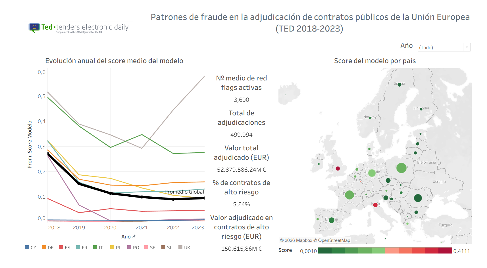

# Detección de Patrones de Fraude en la Adjudicación de Contratos Públicos de la UE (TED 2018-2023)

Trabajo Fin de Máster — **Máster Universitario en Data Science, Big Data y Business Analytics (UCM Online)**.

**Calificación: 9/10.**

Sistema analítico que combina las 22 *red flags* de fraude en contratación pública de la OCDE (2016) con cuatro modelos de *machine learning* para priorizar adjudicaciones sospechosas de la base de datos TED (*Tenders Electronic Daily*), el suplemento al *Official Journal* de la UE, sobre 4.256.060 adjudicaciones (2018-2023).

> **English summary** — MSc thesis (graded 9/10) that scores EU public procurement awards by fraud risk.
> 4.26M awards (TED 2018–2023) processed with **PySpark** from 7.5 GB of raw CSV; 32 features engineered from
> 22 OECD red flags; four models compared (Spark MLlib Random Forest, Isolation Forest, autoencoder and a DNN
> with entity embeddings); SHAP explanations and a Tableau dashboard. Best result without label leakage:
> **AUROC 0.985 / AUPRC 0.829**.

> ⚠️ **Nota ética**: este trabajo no "acusa" a nadie. Los *scores* son una priorización basada en heurísticas OCDE y aprendizaje no supervisado — *red flags* no demuestran fraude —, sin validación con casos judiciales confirmados. El sistema señala contratos para revisión humana; la investigación corresponde a los auditores.

## Pipeline

```
TED CSVs (UE)                        ~7,5 GB · 13,9M filas CAN+CN
   │  PySpark: limpieza CAN/CN, validación XSD, deduplicación
   ▼
Parquet consolidado (cruce CAN←CN)   4.256.060 adjudicaciones
   │  Feature engineering: 22 red flags OCDE + 5 features continuas
   │  RF_SCORE (suma ponderada, normalizada 20,50) + RF_LABEL (P95 = 0,3122)
   ▼
Tabla maestra de features            4.256.060 × 69 columnas
   ├─ EDA (10 figuras)
   ├─ Modelado (4 modelos) ── Experimentos A/B contra circularidad
   ├─ Interpretabilidad SHAP
   ├─ Motor de inferencia (online + batch)
   └─ Dashboard Tableau (muestra 500k)
```

## Estructura del repositorio

```
├── notebooks/TFM_analysis.ipynb   # TODO el pipeline (Fases 1-6), único entregable ejecutable
├── docs/
│   ├── memoria_TFM.md/.docx/.pdf  # Memoria del TFM (20 caras + portada/índice/biblio)
│   ├── anexo_A..E_*.md/.docx      # 5 anexos (individuales y combinados en TFM_memoria_anexos)
│   ├── generator_memoria.py       # Genera memoria_TFM.docx/pdf desde el .md
│   ├── generator_anexos.py        # Genera los DOCX de anexos desde los .md
│   └── figuras/                   # Figuras del EDA, SHAP y dashboards (PNG)
├── models/                        # Artefactos serializados (.keras, .joblib, metrics.json)
├── dashboard/                     # Libro3.twbx + capturas Dashboard1/2.png (muestra CSV no versionada)
├── data/                          # (no versionado) raw/ processed/ features/
└── env_analytics/                 # (no versionado) entorno virtual
```

## Resultados principales

| Modelo | Tipo | AUROC | AUPRC | F1 | Tiempo |
|---|---|---|---|---|---|
| Random Forest (Spark MLlib) | Supervisado distribuido | 0,9979 | 0,9742 | 0,8983 | 252 s |
| Isolation Forest | No supervisado | 0,82 | 0,19 | 0,26 | 0,3 s |
| Autoencoder (Keras) | No supervisado | 0,85 | 0,21 | 0,32 | 23 s |
| DNN (Keras) | Supervisado débil | 1,0000* | 1,0000* | 0,9259 | 35 s |

\* Métricas infladas por circularidad (la pseudo-etiqueta deriva de las mismas *features* de entrada). Sin las 22 *red flags* en la entrada, con variables crudas + *entity embeddings* (Experimento B): **AUROC 0,9846 · AUPRC 0,8292 · F1 0,7278** — el resultado principal y honesto del trabajo. Detalle y análisis crítico en la memoria (secciones 5.6-5.7) y el Anexo C.



**Inferencia**: `predecir()` (Fase 6 del notebook) puntúa adjudicaciones nuevas en ~0,21 ms/predicción (batch 1.000, CPU) devolviendo `riesgo_score`, etiqueta BAJO/MEDIO/ALTO y las *red flags* activas que justifican la alerta.

## Requisitos

- Python 3.12
- Java 8/11/17 (para PySpark; cualquier LTS en soporte funciona)
- ~16 GB de RAM recomendados (el notebook usa un *driver* local de 48 GB; con menos, ajustar `spark.driver.memory` y cargar en Pandas solo las columnas necesarias, como hace el notebook)

## Instalación

```bash
git clone https://github.com/Feguar-Learn/tfm-ted-fraud-detection.git
cd tfm-ted-fraud-detection
python -m venv env_analytics
source env_analytics/bin/activate      # Windows: env_analytics\Scripts\activate
pip install -r requirements.txt
```

## Datos

TED no permite redistribución, así que los datos no están en el repo. Para reproducir:

1. Descarga los CSV originales 2018-2023 de [TED](https://ted.europa.eu/) (Contract Award Notices + Contract Notices, ~7,5 GB) en `data/raw/`.
2. Ejecuta el notebook `notebooks/TFM_analysis.ipynb` de principio a fin (semilla 0): limpieza → cruce → *features* → EDA → modelado → SHAP → inferencia.
3. Alternativa ligera sin TED: el notebook está pensado para correr en orden; los *artefactos* de `models/` y las figuras de `docs/figuras/` permiten revisar resultados sin re-entrenar.

Los *datasets* intermedios que produce el pipeline (`data/processed/*.parquet`, `data/features/ted_features.parquet`, ~650 MB) tampoco se versionan.

## Reproducibilidad

- Semilla global 0 (`random_state=0`, `default_rng(0)`).
- `models/metrics.json` guarda dispositivo, semilla y métricas completas por modelo.
- Los tiempos de la tabla anterior son de una ejecución real completa en CPU (48 GB RAM).

## Estructura de la memoria

| Documento | Contenido |
|---|---|
| `docs/memoria_TFM.docx` | Memoria final (portada, índice, 10 secciones, biblio) |
| `docs/anexo_A_calidad_datos.docx` | Calidad del dataset TED (Fase 1) |
| `docs/anexo_B_eda.docx` | EDA con las 10 figuras (Fase 3) |
| `docs/anexo_C_modelado.docx` | Modelado y experimentos A/B (Fase 4) |
| `docs/anexo_D_interpretabilidad.docx` | SHAP (Fase 5) |
| `docs/anexo_E_productivizacion.docx` | Inferencia online/batch + dashboard (Fase 6) |
| `docs/TFM_memoria_anexos.docx` | Los cinco anexos combinados |
| `docs/presentacion_TFM.pptx` | Presentación de 10 diapositivas para el vídeo de defensa |
| `docs/guia_grabacion_video.docx` | Guion cronometrado para grabar el vídeo (máx. 5 min) |
| `docs/guia_checks_finales.docx` | Checklist final de entrega (incluye ejecutar el notebook fuera de OpenCode) |

## Licencia

MIT — ver [LICENSE](LICENSE). Los datos TED siguen sujeto a sus propios términos de uso.