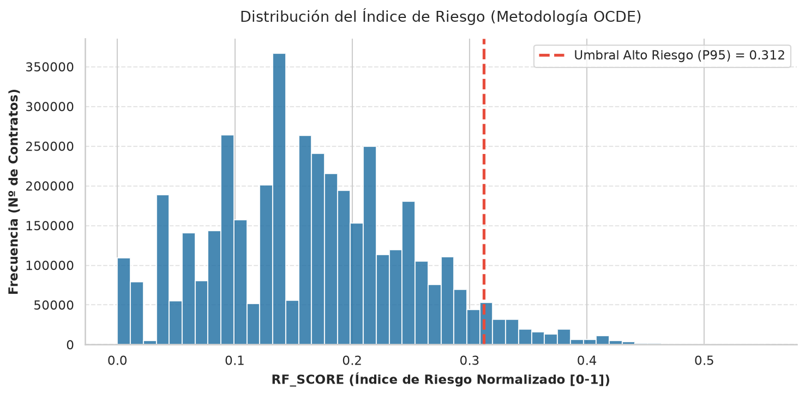
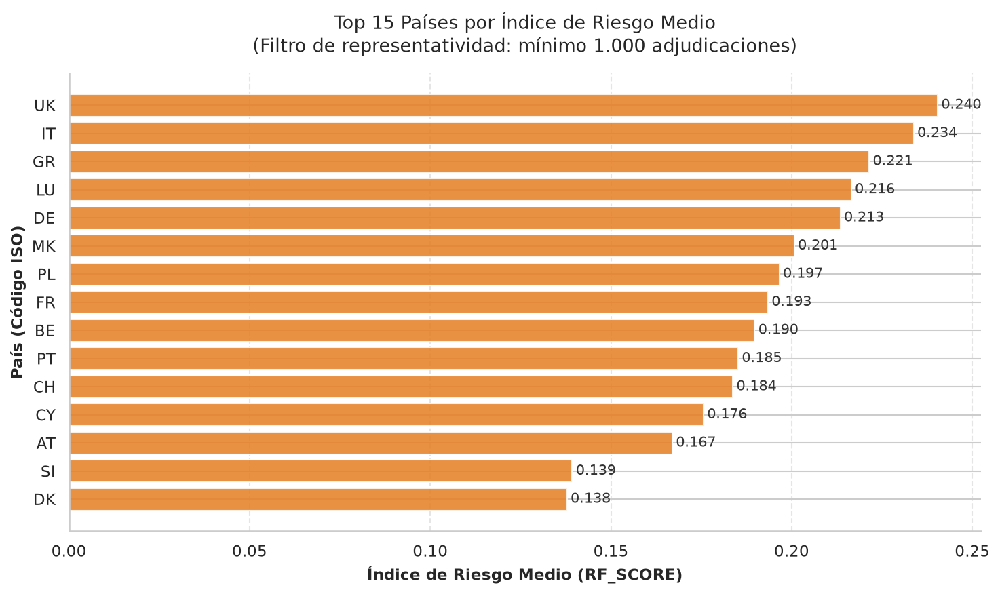
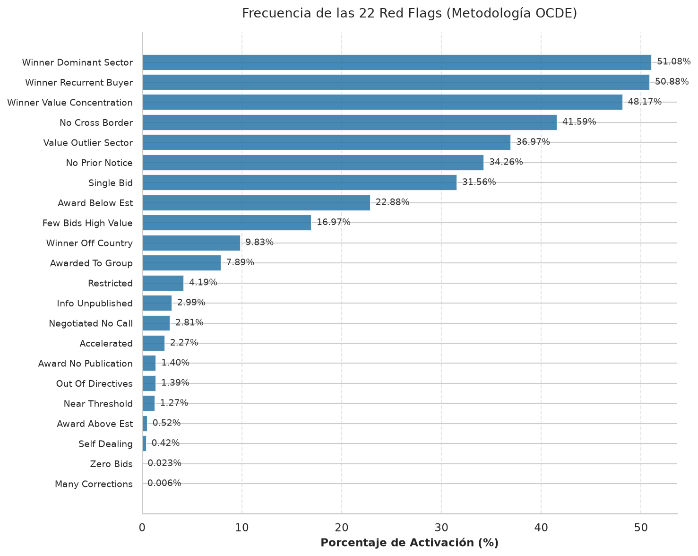
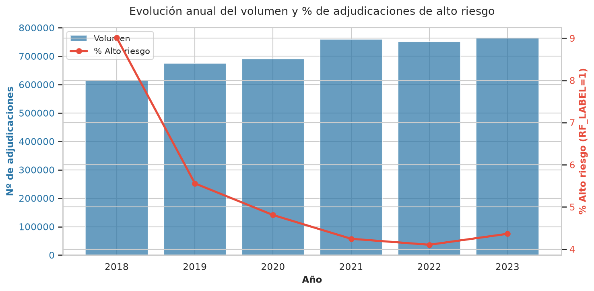
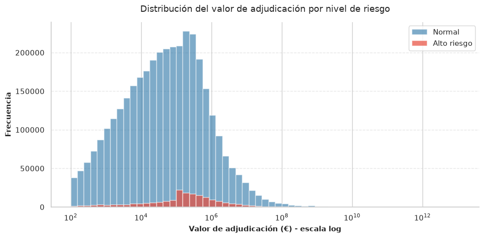
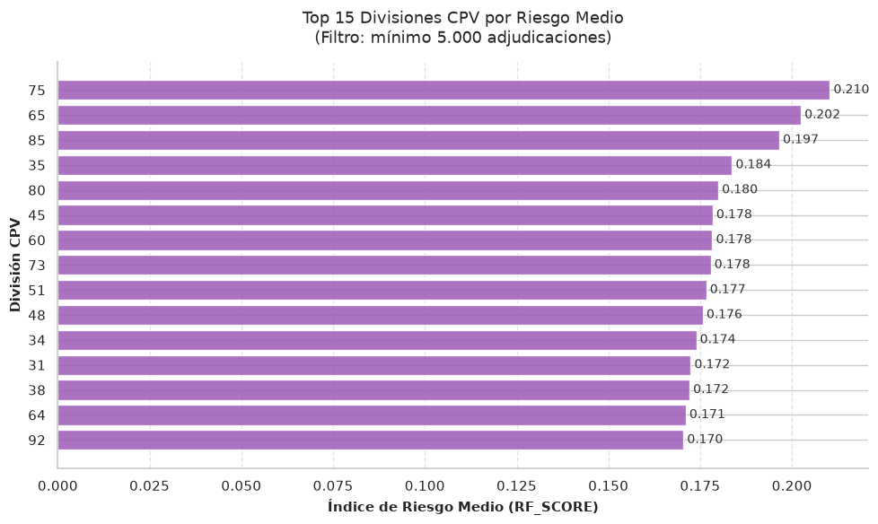
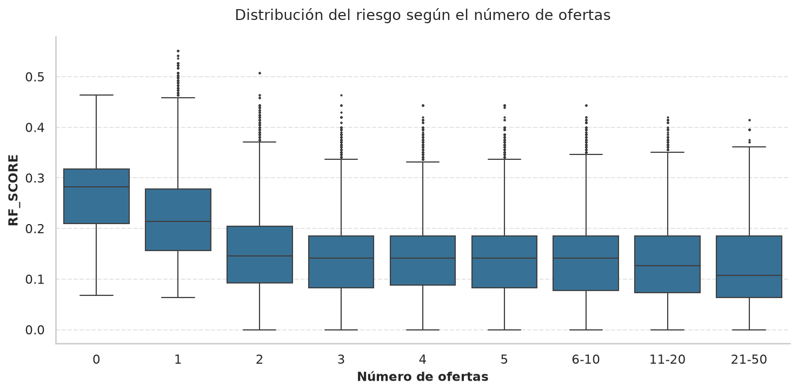
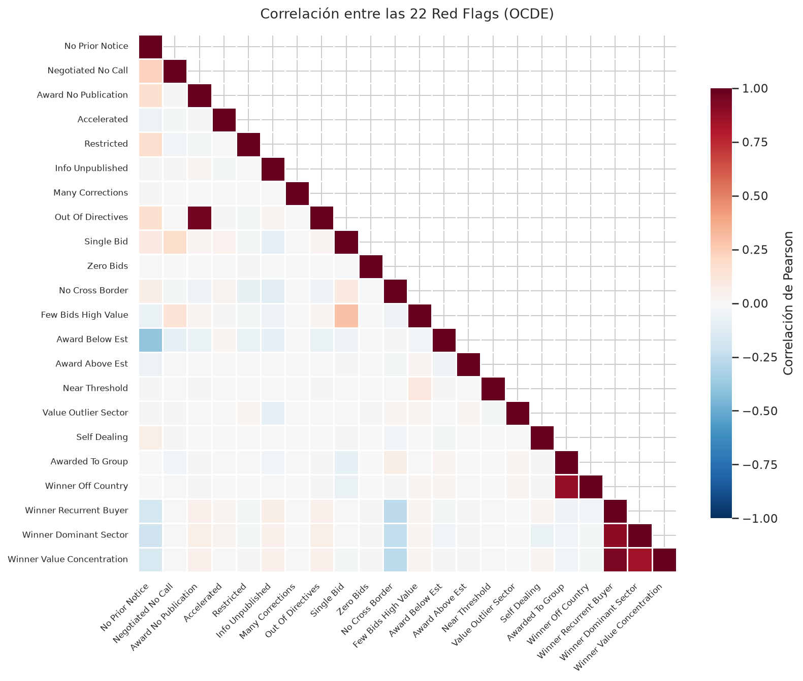
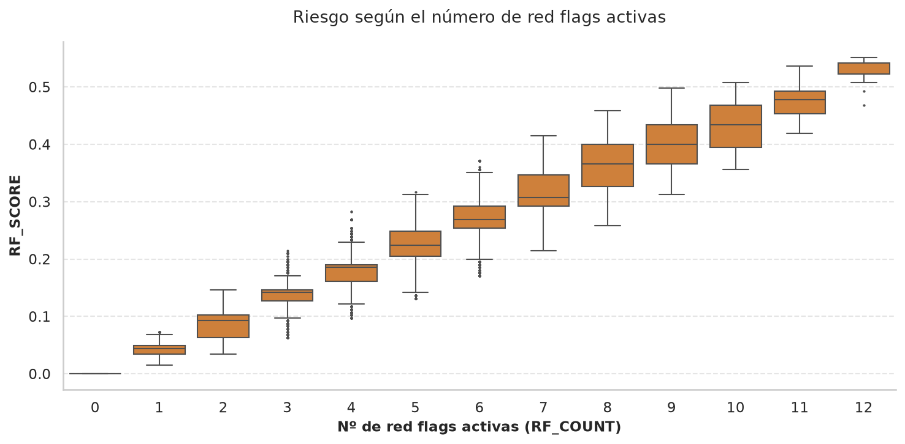
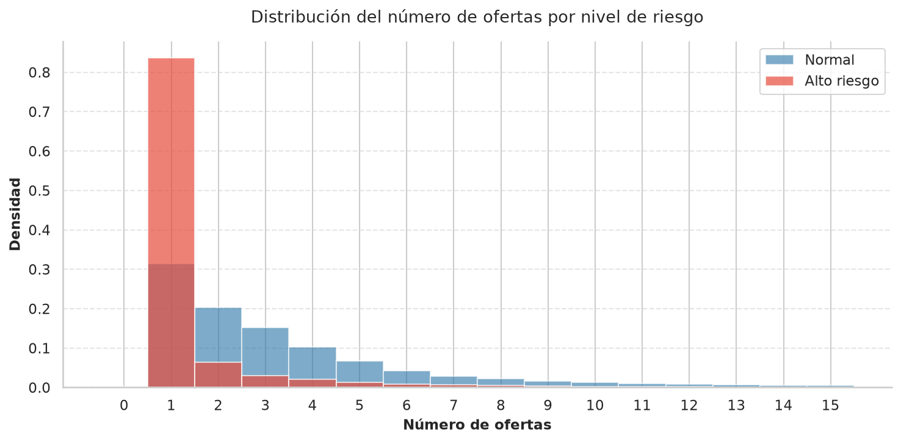

# Anexo B — Análisis descriptivo exploratorio (EDA)

Este anexo documenta el análisis descriptivo exploratorio de la tabla maestra de *features* (4.256.060 adjudicaciones a nivel `ID_AWARD`), cuya lectura interpretativa condensada se encuentra en la sección 4 de la memoria. El análisis vive en el notebook `notebooks/TFM_analysis.ipynb` (Fase 3), que es el entregable único y reproducible; sus diez figuras son las Figuras 1 a 10 de la memoria.

---

## 1. Método

Se cargó el *parquet* de *features* en Pandas seleccionando solo las 31 columnas necesarias para el EDA (cargar las 69 columnas completas con 4,26M de filas agotaba la memoria disponible). Las agregaciones se calcularon con Pandas y la visualización con matplotlib/seaborn, una figura por celda del notebook, exportadas a PNG a 150 DPI y guardadas en `docs/figuras/` con el prefijo `fig_`.

| Figura del anexo | Archivo | Contenido |
|--------|---------|-----------|
| B.1 (= Figura 1 de la memoria) | `figuras/fig_rf_score_p95.png` | Distribución del `RF_SCORE` y umbral del percentil 95 |
| B.2 (= Figura 2) | `figuras/fig_top15_paises.png` | *Top 15* de países por `RF_SCORE` medio (mínimo 1.000 adjudicaciones) |
| B.3 (= Figura 3) | `figuras/fig_frecuencia_flags.png` | Frecuencia de activación de las 22 *red flags* |
| B.4 (= Figura 4) | `figuras/fig_evolucion_riesgo.png` | Volumen anual y porcentaje de alto riesgo (doble eje) |
| B.5 (= Figura 5) | `figuras/fig_valor_log.png` | Valor de adjudicación en escala logarítmica, alto riesgo frente a normal |
| B.6 (= Figura 6) | `figuras/fig_top15_cpv.png` | *Top 15* de divisiones CPV por `RF_SCORE` medio (mínimo 5.000 adjudicaciones) |
| B.7 (= Figura 7) | `figuras/fig_boxplot_ofertas.png` | `RF_SCORE` por número de ofertas en intervalos |
| B.8 (= Figura 8) | `figuras/fig_correlacion_flags.png` | Correlación de Pearson entre las 22 *red flags* |
| B.9 (= Figura 9) | `figuras/fig_boxplot_rfcount.png` | `RF_SCORE` según `RF_COUNT` |
| B.10 (= Figura 10) | `figuras/fig_distrib_ofertas.png` | Número de ofertas, alto riesgo frente a normal, histograma normalizado |

---

## 2. Figuras y resultados

### 2.1 Distribución del índice de riesgo (Figura B.1)

Método: histograma del `RF_SCORE` sobre las 4.256.060 filas, con línea vertical en el percentil 95 calculado en la Fase 2 con `approxQuantile` (0,3122; la memoria lo redondea a 0,312). Resultado: la distribución está muy sesgada a la izquierda, la mayoría de contratos puntúa bajo y solo una cola larga llega hasta el 1; todo lo que queda a la derecha del corte se etiqueta con `RF_LABEL`=1 (222.676 casos, el 5,23%). Esta forma condicionó la evaluación del modelado: con un 5% de positivos se eligieron AUROC y AUPRC frente a accuracy.

### 2.2 Riesgo por país (Figura B.2)

Método: media de `RF_SCORE` y recuento por `ISO_COUNTRY_CODE`, exigiendo un mínimo de 1.000 contratos para evitar el ruido estadístico de muestras pequeñas, y ordenando de mayor a menor. Resultado: la mitad sur y este de la UE tiende a activar más *red flags* que la mitad norte, en línea con los estudios de integridad de la Comisión Europea. No se identifican países concretos porque las *red flags* no demuestran fraude.

### 2.3 Frecuencia de las 22 red flags (Figura B.3)

Método: media de cada una de las 22 columnas binarias `RF_*` sobre el total, ordenada de menor a mayor frecuencia. Resultado: las tres más frecuentes son `RF_WINNER_DOMINANT_SECTOR` (51,08%), `RF_WINNER_RECURRENT_BUYER` (50,88%) y `RF_WINNER_VALUE_CONCENTRATION` (48,17%): en más de la mitad de las adjudicaciones el ganador es recurrente o domina su sector. Conviene leerlo con cuidado, porque la concentración de proveedores es estructural en la contratación pública; el problema aparece cuando se alcanzan los umbrales del 70-85% definidos en este trabajo. En el extremo opuesto, `RF_MANY_CORRECTIONS` (0,01%), `RF_ZERO_BIDS` (0,02%) y `RF_SELF_DEALING` (0,42%) son raras pero llevan los pesos más altos: cuando se activan, constituyen una señal de alerta fuerte.

### 2.4 Evolución anual del volumen y el riesgo (Figura B.4)

Método: agregación por `YEAR` con recuento de adjudicaciones y media de `RF_LABEL`, representada con doble eje (barras de volumen, línea de porcentaje). Resultado: el volumen se mantiene estable a lo largo de 2018-2023 y la tasa de alto riesgo ronda el 5%, lo esperado porque la etiqueta se define por un percentil y es un corte relativo por construcción. Lo que cambia con el tiempo es la composición de ese 5%, no su tamaño.

### 2.5 Distribución del valor de adjudicación (Figura B.5)

Método: histograma de `AWARD_VALUE_EURO_FIN_1` en escala logarítmica (intervalos logarítmicos entre 10² y 10⁹ euros), separando `RF_LABEL`=1 frente a 0, descartando ceros y negativos por carecer de sentido económico. Resultado: la distribución es aproximadamente log-normal, con moda en torno a 10.000-50.000 €. El alto riesgo se concentra ligeramente en valores más altos (varias *red flags* dependen del valor), pero la diferencia no es dramática: hay sospechosas en todos los rangos y el valor por sí solo no discrimina.

### 2.6 Riesgo por sector CPV (Figura B.6)

Método: media de `RF_SCORE` por `CPV_DIVISION` con un mínimo de 5.000 adjudicaciones (mismo criterio anti-ruido que en la Figura B.2), ordenado de mayor a menor. Resultado: las divisiones de administración pública (75), servicios públicos de suministros (65) y sanidad y servicios sociales (85) encabezan el ranking con un `RF_SCORE` medio cercano a 0,20. Esto refleja una mayor presencia recurrente de señales de alerta en estas categorías, debida a menudo a contrataciones de urgencia, marcos cerrados o especificidad de los proveedores. No implica necesariamente fraude sistemático, pero sí delimita los sectores donde la acumulación de factores de riesgo exige concentrar prioritariamente las labores de auditoría.

### 2.7 Riesgo según el número de ofertas (Figura B.7)

Método: el número de ofertas presenta una cola larguísima, así que se filtraron los valores válidos, se excluyeron los extremos por encima de 50 y se agrupó en los intervalos 0, 1, 2, 3, 4, 5, 6-10, 11-20 y 21-50; sobre cada grupo se representó el boxplot de `RF_SCORE`. Resultado: es la gráfica que más claramente muestra la relación entre competencia y riesgo; los contratos con 0 o 1 oferta tienen la mediana más alta y más dispersión, y a partir de 3-4 ofertas el riesgo cae y se estabiliza. Confirma lo que dice la OCDE: la falta de competencia es el principal predictor de riesgo.

### 2.8 Correlación entre red flags (Figura B.8)

Método: matriz de correlación de Pearson de las 22 columnas binarias, con la mitad superior enmascarada por simetría y escala divergente centrada en 0. Resultado: la mayoría de correlaciones son bajas, lo que indica señales distintas sin redundancia importante; las más altas se dan dentro de la misma categoría (por ejemplo, `RF_NO_PRIOR_NOTICE` con `RF_NEGOTIATED_NO_CALL`, o las tres de concentración del ganador entre sí, que miden facetas del mismo fenómeno). Esto descarta una multicolinealidad problemática al incluirlas todas en el modelo.

### 2.9 Riesgo según el número de red flags activas (Figura B.9)

Método: boxplot de `RF_SCORE` para cada valor de `RF_COUNT` (número de *red flags* activas por adjudicación), descartando nulos. Resultado: casi una verificación de coherencia interna del índice; la relación es monótona creciente y la dispersión crece porque cada *red flag* pesa distinto (una `RF_SELF_DEALING` de peso 1,5 da más *score* que una `RF_NO_CROSS_BORDER` de 0,4). No hay casos con muchas *red flags* activas y *score* bajo.

### 2.10 Competencia: alto riesgo frente a normal (Figura B.10)

Método: histograma del número de ofertas limitado a 15 (el 99% de los casos queda por debajo), con densidades normalizadas para que la comparación sea legible (hay 19 veces más normales que sospechosos). Resultado: la comparación es nítida; el alto riesgo concentra la masa en 0-1 ofertas (mediana 1) y el riesgo normal se reparte en 2-5 (mediana 3-4). Es la señal que más separa los dos grupos y la hipótesis central del trabajo confirmada por los datos.

---

## 3. Conclusiones del EDA

Tres conclusiones del EDA condicionaron el modelado, recogidas en la memoria:

1. **Desbalance**: un 5% de positivos (222.676 casos) impone evaluar con AUROC y AUPRC y compensar el desbalanceo en el entrenamiento supervisado.
2. **Correlación por categorías**: las *red flags* son complementarias entre categorías y redundantes dentro de cada una; incluirlas todas no introduce multicolinealidad problemática.
3. **Nulos estructurales**: campos como el valor estimado faltan de forma sistemática, lo que exigió máscaras binarias de nulo además de la imputación, documentada en el Anexo C.