# Detección de Patrones de Fraude en la Adjudicación de Contratos Públicos de la Unión Europea (TED 2018-2023)

**Trabajo Fin de Máster**
Máster Universitario en Data Science, Big Data y Business Analytics (UCM Online)

**Autor:** Fernando Gutiérrez Arenas
**Tutores:** Carlos Ortega, Santiago Mota
**Fecha:** Septiembre 2026

---

## Índice

1. Introducción y objetivos
2. Datos y limpieza con PySpark
3. Feature engineering: las 22 *red flags* de la OCDE
4. Análisis descriptivo (EDA)
5. Modelado
6. Interpretabilidad con SHAP
7. Productivización
8. Dashboard interactivo en Tableau
9. Conclusiones y trabajo futuro
10. Bibliografía

---

## 1. Introducción y objetivos

Los contratos públicos mueven una cantidad enorme de dinero en la Unión Europea: el mercado público comunitario representa algo más del 14% del PIB (estimaciones de la Comisión Europea en sus informes de integridad), y las pérdidas asociadas a fraude y corrupción en la contratación pública se sitúan en una horquilla de varios miles de millones de euros al año. Detrás de cada adjudicación sospechosa hay dinero público que se asigna sin competencia, va a parar a empresas vinculadas al propio comprador, o se repite en manos del mismo ganador en un sector concreto. El problema no es nuevo, pero sí lo es la cantidad de datos públicos disponibles para abordarlo a escala.

La UE publica en abierto casi toda su actividad de contratación en TED, Tenders Electronic Daily, el diario oficial de licitaciones y adjudicaciones europeas: cada vez que un organismo público adjudica un contrato por encima de cierto umbral, está obligado a remitir un formulario estructurado que acaba allí. Entre 2018 y 2023 eso suma millones de adjudicaciones con decenas de variables cada una (país, tipo de procedimiento, número de ofertas, valores estimado y adjudicado, sector CPV, datos del ganador y del comprador, fechas, correcciones). Es un *dataset* público, enorme y, hasta donde alcanza la revisión realizada, poco explotado en comparación con los típicos de Kaggle.

El objetivo de este TFM es construir un sistema que puntúe adjudicaciones de contratos públicos según su probabilidad de ser fraudulentas. Lo que se busca es una combinación de dos ingredientes: las *red flags* que la OCDE describió en su *handbook* de 2016 sobre contratación pública, que son reglas interpretables de riesgo; y modelos de *machine learning* que aprendan de esas reglas y, en el caso de los modelos no supervisados, que intenten encontrar patrones sospechosos que las propias reglas no cubren. El resultado es un *score* de riesgo por adjudicación que se puede usar para priorizar auditorías, para filtrar casos en un *dashboard*, o para alimentar un sistema de alertas.

La elección de este *dataset* responde a tres motivos: su tamaño (tras la limpieza se obtienen 4.256.060 adjudicaciones, lo que descarta a Pandas y obliga a PySpark), su carácter público y reproducible (cualquier persona puede descargar los CSV de data.europa.eu y repetir el proceso), y su escasa explotación —las búsquedas de "fraud detection *dataset*" en Kaggle devuelven siempre los mismos conjuntos (Credit Card Fraud de ULB, PaySim, IEEE-CIS), mientras TED apenas aparece, y solo para análisis descriptivo, no para modelado de fraude.

Dos cuestiones conviene dejar claras desde el principio. Primera, el enfoque no es el de un artículo científico sino el de una solución empresarial: a un equipo de Negocio o de Auditoría Pública no le sirve un *paper*, le sirve una herramienta que puntúe adjudicaciones y diga cuáles mirar primero; por eso la memoria explica qué se ha hecho, por qué y qué límites tiene. Segunda, no hay etiquetas reales de fraude —TED no confirma qué contratos lo fueron—: lo único disponible son señales de riesgo, así que lo que se construye es un sistema de priorización, no de acusación, y todo contrato marcado exige revisión manual antes de extraer ninguna conclusión. Este punto se desarrolla en las conclusiones.

## 2. Datos y limpieza con PySpark

TED publica dos tipos de formulario relevantes para este trabajo. Por un lado, los Contract Award Notices (CAN), los anuncios de adjudicación: cada fila es un contrato ya adjudicado, con los datos del ganador, del comprador, del valor final y del procedimiento. Por otro, los Contract Notices (CN), los anuncios de licitación: cada fila es un contrato que se va a sacar a concurso, con el valor estimado, el tipo de procedimiento previsto y las fechas. Los CAN suman unos 6,2 millones de filas (3,9 GB, 75 columnas) y los CN 7,7 millones (3,6 GB, 64 columnas): 7,5 GB de CSV que no caben en memoria con Pandas, por lo que el procesamiento se realizó con PySpark en local (*driver* con hasta 48 GB de RAM, ajustados automáticamente a la memoria disponible del equipo). El procedimiento detallado de limpieza se documenta en el Anexo A.

La limpieza se realizó en varios pasos. Se leyeron los dos CSV con `spark.read.csv` indicando el esquema de tipos, porque si Spark lo infiere pierde tiempo y se equivoca con algunas columnas numéricas que traen comas. El primer filtro eliminó los registros con `CANCELLED=1`, que son adjudicaciones anuladas e inservibles para entrenar. Después se quitaron duplicados por `ID_AWARD`, porque el mismo contrato puede aparecer repetido si hay correcciones o si se publica en varios formularios, conservando la versión más reciente. También se normalizaron las variables categóricas: países a mayúsculas, espacios fuera de los códigos CPV, y unificación de los valores nulos (`NA`, `""`, `None`, `-1`) a `null` real de Spark.

La parte más delicada fue el cruce entre CAN y CN, necesario porque el valor estimado del contrato —que permite calcular el ratio adjudicado/presupuesto, una de las *red flags* más importantes— solo está en el CN. El cruce es un LEFT JOIN de CAN contra CN por `ID_NOTICE_CAN = FUTURE_CAN_ID` (cada adjudicación lleva el identificador del anuncio de licitación del que viene). Se usó LEFT y no INNER porque hay adjudicaciones cuyo CN no aparece o tiene un ID distinto: no se quería perderlas de la tabla maestra, solo dejar a nulo los campos del CN.

El cálculo de `DURATION_M` se resolvió restando la fecha de recepción de ofertas a la fecha de adjudicación y dividiendo entre 30 para obtener meses; los contratos con fechas incoherentes o duraciones no positivas (en su mayoría errores de carga) se dejaron a nulo para no introducir ruido en el modelo. Tras toda la limpieza y el cruce se obtuvieron 4.256.060 adjudicaciones consolidadas a nivel `ID_AWARD`, en lo que constituye la tabla maestra del trabajo: es sobre ella sobre la que se opera a partir de aquí.

## 3. Feature engineering: las 22 red flags de la OCDE

El trabajo se fundamenta en las *red flags* de la OCDE, publicadas en el *handbook* *Government at a Glance 2016: Procurement* —señales de alerta que, cuando aparecen en un contrato, no demuestran fraude pero sí aumentan la probabilidad de que lo haya. La idea es la misma que en el sector financiero: una operación en efectivo grande no es fraude, pero conviene mirarla. Se trabajó con 22 de ellas, las calculables a partir de las variables de TED, agrupadas en seis categorías: acceso a la competencia, integridad del proceso, transparencia, oferta y demanda, características del contrato y comportamiento del ganador.

Esta es la tabla completa de las 22 *red flags*, agrupadas por categoría, con una descripción corta y el peso asignado a cada una en el *score* final:

| Categoría | Red flag | Descripción | Peso |
|---|---|---|---|
| Acceso a la competencia | RF_NO_PRIOR_NOTICE | Sin convocatoria previa publicada | 1.5 |
| Acceso a la competencia | RF_NEGOTIATED_NO_CALL | Procedimiento negociado sin licitación previa | 1.2 |
| Acceso a la competencia | RF_AWARD_NO_PUBLICATION | Adjudicación no publicada | 1.5 |
| Acceso a la competencia | RF_ACCELERATED | Procedimiento acelerado sin justificación | 0.8 |
| Acceso a la competencia | RF_RESTRICTED | Procedimiento restringido | 0.7 |
| Acceso a la competencia | RF_INFO_UNPUBLISHED | Información relevante no publicada | 1.0 |
| Integridad del proceso | RF_MANY_CORRECTIONS | Múltiples correcciones al contrato | 0.5 |
| Integridad del proceso | RF_OUT_OF_DIRECTIVES | Contrato fuera de las directivas UE | 0.6 |
| Transparencia / Oferta | RF_SINGLE_BID | Una sola oferta recibida | 1.3 |
| Transparencia / Oferta | RF_ZERO_BIDS | Cero ofertas recibidas | 1.4 |
| Transparencia / Oferta | RF_NO_CROSS_BORDER | Todas las ofertas son del mismo país | 0.4 |
| Transparencia / Oferta | RF_FEW_BIDS_HIGH_VALUE | Pocas ofertas en un contrato de alto valor | 0.9 |
| Características del contrato | RF_AWARD_BELOW_EST | Adjudicado muy por debajo del presupuesto | 0.9 |
| Características del contrato | RF_AWARD_ABOVE_EST | Adjudicado muy por encima del presupuesto | 1.0 |
| Características del contrato | RF_NEAR_THRESHOLD | Valor justo por debajo del umbral de publicidad | 0.8 |
| Características del contrato | RF_VALUE_OUTLIER_SECTOR | Valor atípico dentro del sector CPV | 0.7 |
| Comportamiento del ganador | RF_SELF_DEALING | Ganador vinculado al comprador | 1.5 |
| Comportamiento del ganador | RF_AWARDED_TO_GROUP | Adjudicado a un grupo (no a una empresa concreta) | 0.3 |
| Comportamiento del ganador | RF_WINNER_OFF_COUNTRY | Ganador en un país distinto al del comprador | 0.6 |
| Comportamiento del ganador | RF_WINNER_RECURRENT_BUYER | Mismo ganador se repite con el mismo comprador | 1.1 |
| Comportamiento del ganador | RF_WINNER_DOMINANT_SECTOR | Ganador domina un sector CPV | 0.8 |
| Comportamiento del ganador | RF_WINNER_VALUE_CONCENTRATION | Ganador concentra mucho valor con un comprador | 1.0 |

Sobre los pesos conviene ser honesto: la OCDE no publica números oficiales, solo severidades cualitativas (alta, media, baja). Esa severidad se tradujo en un número entre 0,3 y 1,5 de forma coherente con el *handbook*: las más graves (acceso a la competencia, `RF_SELF_DEALING`) con peso 1,5; las de menor severidad (`RF_NO_CROSS_BORDER`, `RF_AWARDED_TO_GROUP`) con 0,3-0,4. No es una calibración científica, sino una asignación razonable; el sistema está preparado para recalibrarse por un panel de expertos sin tocar nada más.

El cálculo de cada red flag se hizo en PySpark. La mayoría son reglas simples (`RF_SINGLE_BID`: `NUMBER_OFFERS == 1`; `RF_NO_PRIOR_NOTICE`: CN a nulo tras el LEFT JOIN). Otras combinan condiciones (`RF_FEW_BIDS_HIGH_VALUE`: menos de 3 ofertas y valor > 100.000 €; `RF_NEAR_THRESHOLD`: cae en la franja 128.000-142.000 €, justo por debajo del umbral de publicidad). Las del comportamiento del ganador requieren *window functions*: `RF_WINNER_RECURRENT_BUYER` particiona por pareja comprador-ganador y se activa cuando el ganador acumula más del 70% de los contratos del comprador (mínimo 10 adjudicaciones); `RF_WINNER_DOMINANT_SECTOR` hace lo mismo por sector CPV con umbral 40% y mínimo 20 contratos; `RF_SELF_DEALING` compara identificadores de ganador y comprador, la más delicada porque TED no da un identificador fiscal único.

Además de las 22 binarias se añadieron 5 *features* continuas: **RATIO_AWARD_EST** (valor adjudicado/estimado, truncado a los percentiles extremos [P1, P99] según el método de Winsor), **VALUE_DEV_SECTOR** (desviación logarítmica respecto a la mediana del sector CPV), **WINNER_SHARE_BUYER** y **WINNER_SHARE_SECTOR** (cuota del ganador sobre el comprador y sobre el sector), y **WINNER_VALUE_SHARE_BUYER** (la misma cuota ponderada por valor, que captura concentración de dinero y no de frecuencia).

Como varias de estas continuas tienen nulos estructurales (`RATIO_AWARD_EST` es nulo en el 69% de las filas porque muchos contratos carecen de convocatoria previa), no se imputó: se añadieron 5 máscaras binarias que indican la ausencia del valor, porque ese hecho es en sí mismo informativo y es además una señal de riesgo. Con las 27 *features* y las 5 máscaras los modelos reciben 32 dimensiones.

Para la etiqueta supervisada se construyó una pseudo-etiqueta a partir del propio *score*: `RF_SCORE` es la suma ponderada de las 22 *red flags* normalizada por el máximo teórico (20,50), y `RF_LABEL = 1` si el contrato supera el percentil 95 del *score* (umbral resultante: 0,3122). Quedaron 222.676 adjudicaciones marcadas como alto riesgo, un 5,23% del total. Es importante ser preciso con el significado: `RF_LABEL` no es "es fraude", es "tiene un perfil de riesgo alto según las reglas OCDE". Es un proxy, y esa limitación condiciona todo lo que viene después.

## 4. Análisis descriptivo (EDA)

Antes de pasar a los modelos se realizó un análisis descriptivo de la tabla maestra para entender cómo se distribuyen las variables. Se cargó el *parquet* en Pandas seleccionando solo las 31 columnas necesarias (cargar las 69 con 4,26M de filas agotaba la memoria) y se generaron 10 gráficas que comentan los patrones que condicionaron el modelado. El desarrollo exhaustivo de este apartado se encuentra en el Anexo B.

### 4.1 Distribución del índice de riesgo

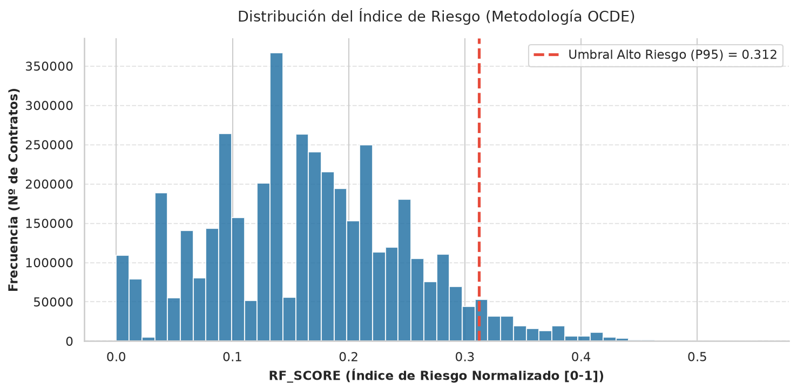

El histograma del `RF_SCORE` está muy sesgado a la izquierda: la inmensa mayoría de contratos tienen puntuaciones bajas y solo una cola larga llega hasta el 1. El corte del percentil 95 cae en 0,312; todo lo que queda a su derecha se etiqueta como alto riesgo. Esta forma condicionó el modelado: con un 5% de positivos, el *accuracy* deja de ser informativo (un modelo que siempre prediga "bajo riesgo" acertaría el 95% sin detectar nada), y por eso la evaluación se hizo con AUROC y AUPRC. El AUROC (área bajo la curva ROC) mide la capacidad del modelo de ordenar los contratos de menor a mayor riesgo en todo el rango; el AUPRC (área bajo la curva *precision-recall*), la precisión que se obtiene al revisar la parte alta del ranking — la que importa cuando se prioriza la revisión manual (Davis y Goadrich, 2006).

### 4.2 Riesgo por país

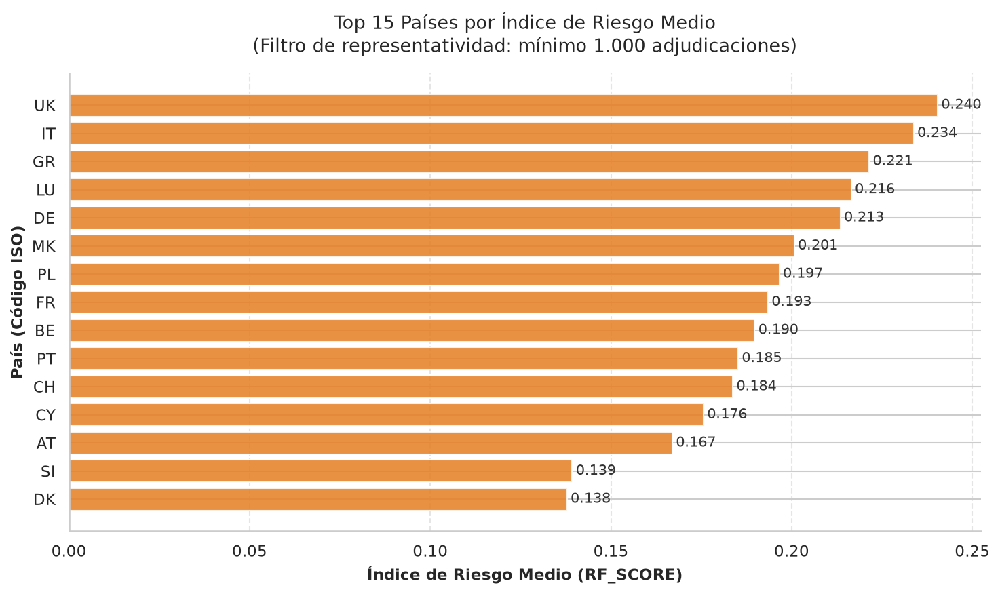

Se ordenaron los países por `RF_SCORE` medio con un mínimo de 1.000 adjudicaciones para evitar ruido estadístico. Se ve un patrón claro: la mitad sur y este de la UE tiende a activar más *red flags* que la mitad norte, coincidiendo con los estudios de integridad de la Comisión Europea. No se entra a apuntar a países concretos porque las *red flags* no demuestran fraude.

### 4.3 Frecuencia de las 22 red flags

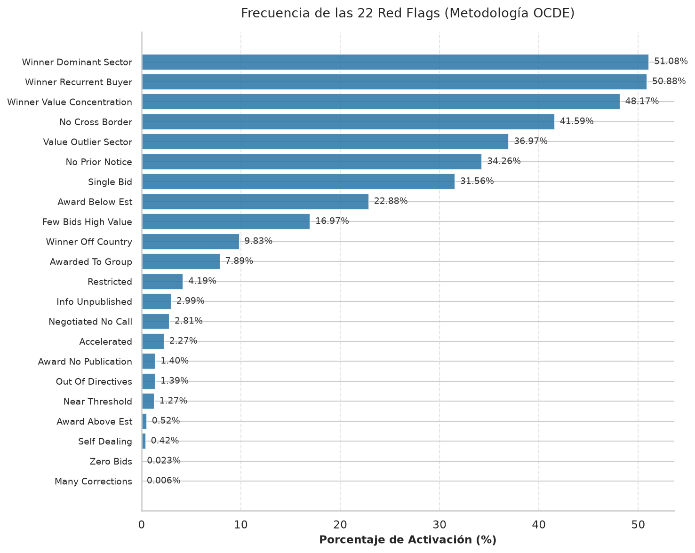

Las tres *red flags* más frecuentes son `RF_WINNER_DOMINANT_SECTOR` (51,08%), `RF_WINNER_RECURRENT_BUYER` (50,88%) y `RF_WINNER_VALUE_CONCENTRATION` (48,17%): en más de la mitad de las adjudicaciones el ganador es recurrente o domina su sector. Conviene leerlo con cuidado: la concentración de proveedores es estructural en la contratación pública, el problema aparece cuando alcanza los umbrales del 70-85% definidos en este trabajo. En el extremo opuesto, `RF_MANY_CORRECTIONS` (0,01%), `RF_ZERO_BIDS` (0,02%) y `RF_SELF_DEALING` (0,42%) son raras pero tienen los pesos más altos: cuando se activan constituyen una señal de alerta fuerte.

### 4.4 Evolución anual del volumen y el riesgo

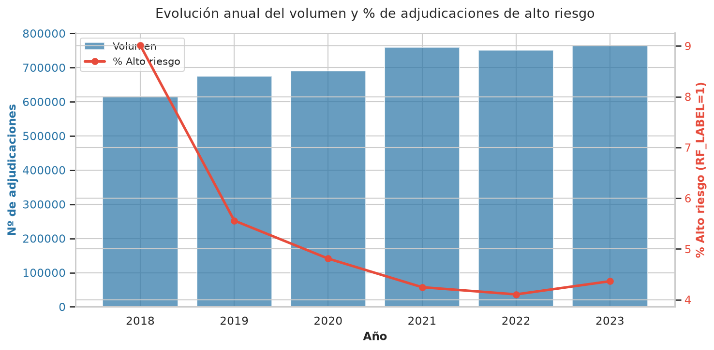

El volumen se mantiene estable a lo largo de 2018-2023 y la tasa de alto riesgo ronda el 5%, lo esperado porque la etiqueta se define por un percentil y es un corte relativo por construcción. Lo que cambia con el tiempo es la composición de ese 5%, no su tamaño.

### 4.5 Distribución del valor de adjudicación

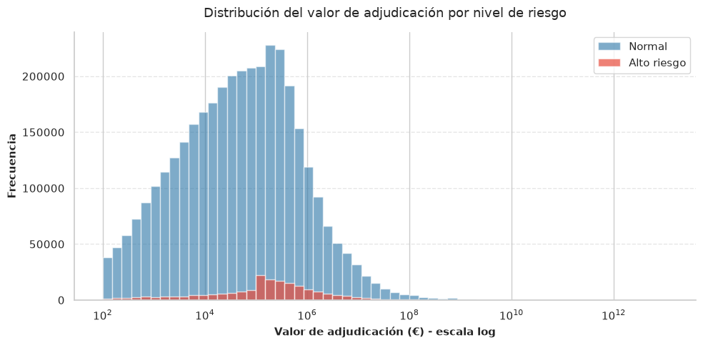

Los importes están muy sesgados y la distribución es aproximadamente log-normal, con moda en torno a 10.000-50.000 €. En escala logarítmica se aprecia que el alto riesgo se concentra ligeramente en valores más altos (varias *red flags* dependen del valor), pero la diferencia no es dramática: hay sospechosas en todos los rangos, y el valor por sí solo no discrimina.

### 4.6 Riesgo por sector CPV

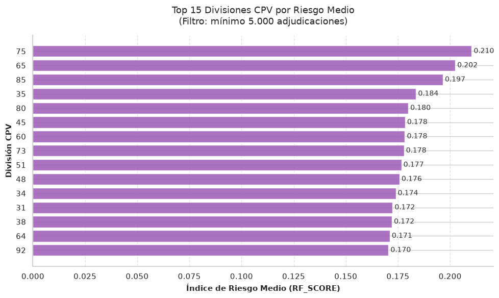

Por divisiones CPV (filtrando un mínimo de 5.000 adjudicaciones), las actividades vinculadas a administración pública (75), servicios públicos de suministros (65) y sanidad y servicios sociales (85) lideran el ranking con un `RF_SCORE` medio cercano a 0,20. Esto refleja una mayor presencia recurrente de señales de alerta en estas categorías, debida a menudo a contrataciones de urgencia, marcos cerrados o especificidad de los proveedores. No implica necesariamente fraude sistemático, pero sí delimita los sectores donde la acumulación de factores de riesgo exige concentrar prioritariamente las labores de auditoría.

### 4.7 Riesgo según el número de ofertas

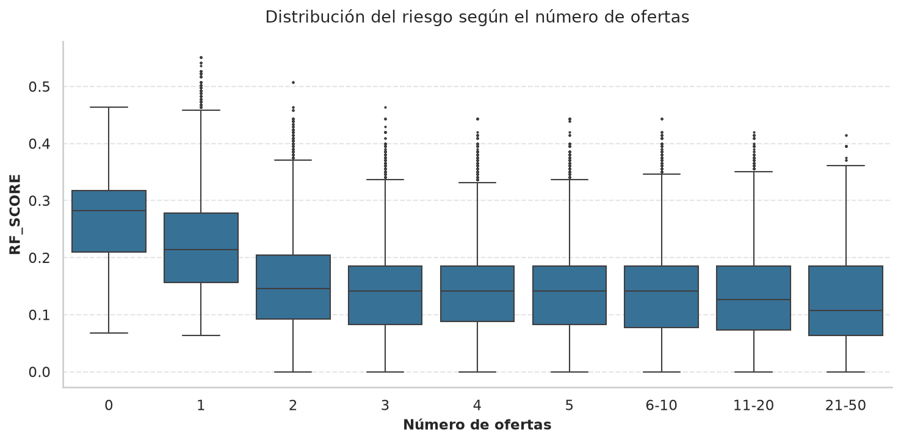

Es la gráfica que más claramente muestra la relación entre competencia y riesgo: a más ofertas, menor `RF_SCORE` medio. Los contratos con 0 o 1 oferta tienen la mediana más alta y más dispersión; a partir de 3-4 ofertas el riesgo cae y se estabiliza. Confirma lo que dice la OCDE: la falta de competencia es el principal predictor de riesgo.

### 4.8 Correlación entre red flags

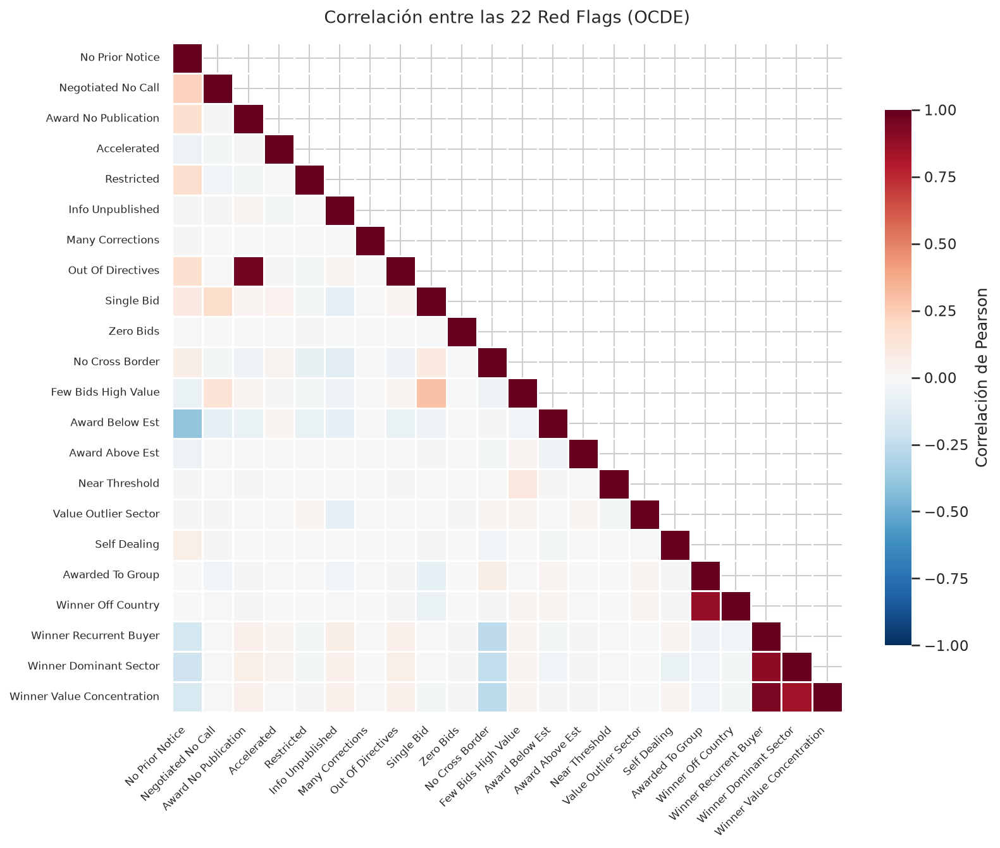

La mayoría de correlaciones entre las 22 *red flags* son bajas, lo que indica que capturan señales distintas sin redundancia importante; las más altas se dan dentro de la misma categoría (p. ej. `RF_NO_PRIOR_NOTICE` con `RF_NEGOTIATED_NO_CALL`, o las tres de concentración del ganador entre sí, que miden facetas del mismo fenómeno). Esto descarta una multicolinealidad problemática al incluirlas todas en el modelo.

### 4.9 Riesgo según el número de red flags activas

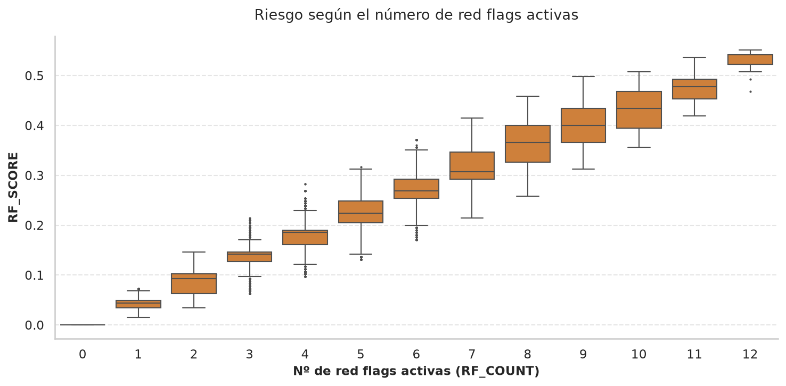

Es casi una verificación de coherencia: la relación entre `RF_COUNT` y `RF_SCORE` es monótona creciente, y la dispersión crece porque cada red flag pesa distinto (una `RF_SELF_DEALING` de peso 1,5 da más *score* que una `RF_NO_CROSS_BORDER` de 0,4). No hay casos con muchas *red flags* activas y *score* bajo.

### 4.10 Competencia: alto riesgo vs normal

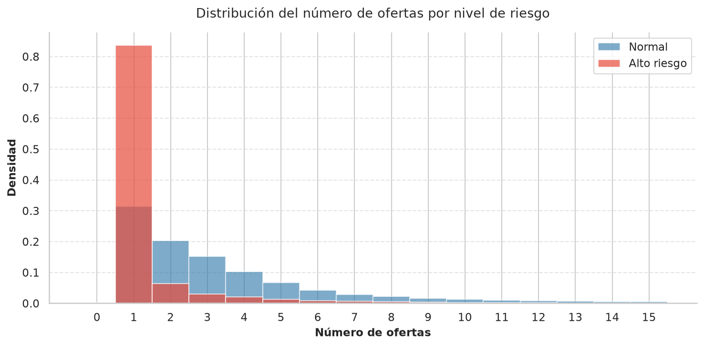

Normalizando por densidad (hay 19 veces más normales que sospechosos), la comparación es nítida: el alto riesgo concentra la masa en 0-1 ofertas (mediana 1) y el riesgo normal se reparte en 2-5 (mediana 3-4). Es la señal que más separa los dos grupos y la hipótesis central del trabajo confirmada por los datos.

Tres conclusiones del EDA condicionaron el modelado: desbalance (5% de positivos), *red flags* correlacionadas dentro de su categoría y nulos estructurales tratados con máscaras.

## 5. Modelado

Esta es la parte central del trabajo. Se entrenaron cuatro modelos con dos objetivos: supervisados que aprenden a reproducir y refinar `RF_LABEL` (Random Forest en Spark, DNN en Keras) y no supervisados que detectan anomalías sin etiqueta (Isolation Forest, autoencoder). Los enfoques son complementarios: los supervisados calibran la frontera de las reglas OCDE y los no supervisados intentan cazar fraude que esas reglas no describen.

### 5.1 Preparación de los datos

Se partió de las 27 *features* (22 binarias + 5 continuas) y se añadieron 5 máscaras de nulos, hasta 32 dimensiones. El escalado se hizo con `StandardScaler` ajustado solo sobre *train* —para no filtrar información del *test*— y la división 80/20 estratificada por `RF_LABEL` (3.404.848 filas de *train*, 851.212 de *test*), lo que mantiene la proporción 5/95 en ambos conjuntos. El paso de Spark a Keras exigió dos ajustes operativos, documentados en el Anexo C: cargar solo las 32 columnas necesarias (las 69 del *parquet* con 4,26M de filas agotan la memoria) y liberar la memoria del *driver* con `spark.stop()` antes de entrenar con TensorFlow.

### 5.2 Random Forest (Spark MLlib)

El primer modelo fue un Random Forest con Spark MLlib, encajando con el motor distribuido ya disponible: sobre 4,26M de filas por 32 columnas, sklearn en CPU es lento y MLlib es natural. El pipeline fue `VectorAssembler` + `RandomForestClassifier` + `TrainValidationSplit` probando `maxDepth` (6, 8) y `numTrees` (50, 100); se optó por `TrainValidationSplit` y no `CrossValidator` porque el *k-fold* multiplicaba el tiempo sin mejorar apenas las métricas. La mejor configuración fue 100 árboles con profundidad 8, con AUROC 0,9979, AUPRC 0,9742 y F1 0,8983 en 252 segundos.

Estos números son altos pero hay que leerlos con cuidado: la etiqueta `RF_LABEL` es un umbral sobre `RF_SCORE`, y `RF_SCORE` es una combinación de las mismas 22 *red flags* que recibe el modelo, así que la relación *features*-etiqueta es casi determinista. Lo que aporta el RF sobre el umbral fijo es la combinación no lineal de *features* y su feature importance nativa, que permitía comunicar a Auditoría "estas 5 *red flags* son las que más pesan": `RF_NO_PRIOR_NOTICE` (0,148), `RF_OUT_OF_DIRECTIVES` (0,121), `RF_SINGLE_BID` (0,120), `RF_NEGOTIATED_NO_CALL` (0,119) y `RF_AWARD_NO_PUBLICATION` (0,095). Además sirve de *baseline* distribuido: escala a 50 millones de adjudicaciones nuevas sin más.

### 5.3 Isolation Forest (sklearn)

El segundo modelo detecta anomalías sin usar la etiqueta: Isolation Forest aísla observaciones y las anómalas necesitan menos divisiones para quedarse solas. Para entrenarlo se extrajo una muestra de 200.000 filas de la clase mayoritaria (lo que permite usar sklearn sin recurrir a implementaciones distribuidas) y se evaluó sobre la tabla maestra completa: AUROC 0,8205, AUPRC 0,1894, F1 0,2617 en 0,3 segundos. El AUPRC tan bajo refleja que marca como anómalas muchas observaciones que la etiqueta no lo son —no necesariamente se equivoca, puede estar cazando cosas fuera de las *red flags*, pero sin etiquetas reales no se puede confirmar. Su debilidad estructural es que no modela interacciones entre *features*: un contrato con `RF_SINGLE_BID` y `RF_WINNER_RECURRENT_BUYER` juntas es mucho más sospechoso que con una sola, y el Isolation Forest no lo ve de forma natural. Por eso rinde claramente por debajo del autoencoder.

### 5.4 Autoencoder (Keras)

El tercer modelo resulta el más interesante: un autoencoder entrenado solo con la clase mayoritaria. Al aprender a reconstruir cómo es un contrato "normal" pasando por un cuello de botella, cualquier contrato que se desvíe del patrón —aunque no active ninguna red flag— produce un error de reconstrucción alto y es identificado como anomalía. Es el modelo valioso para fraude "nuevo" que no encaja en los patrones OCDE, el que pone encima de la mesa casos que las reglas no marcan.

La arquitectura es 32 → 24 → 4 → 24 → 32 con `BatchNormalization` y `Dropout(0.1)` entre capas densas (1.908 parámetros), pérdida MSE, 15 epochs con *batch* de 2048 sobre las 3.226.707 filas normales de *train*, con `EarlyStopping` (paciencia 5) y `ReduceLROnPlateau`. Resultado: AUROC 0,8566, AUPRC 0,2010, F1 0,3171 en 23 segundos. Mejora al Isolation Forest en F1 pero no en AUPRC; su valor no está en la métrica global sino en el tipo de anomalía que captura: aprende una representación conjunta y captura interacciones que el Isolation Forest no ve. Tiene más falsos positivos que los supervisados, pero es el precio razonable por detectar lo que no está en el manual: si solo usas supervisados, siempre buscarás el fraude que ya sabes describir.

### 5.5 DNN clasificador (Keras)

El cuarto modelo es una DNN de clasificación binaria cuya motivación es refinar la frontera de decisión: `RF_LABEL` es un corte binario rígido en el percentil 95, y la DNN aprende una probabilidad continua que suaviza ese corte para los contratos del borde. La arquitectura es 32 → 64 → 32 → 16 → 1 con sigmoid, `BatchNormalization` y `Dropout(0.2)` (4.961 parámetros entrenables), pérdida `binary_crossentropy` y `class_weight` de 18,11 (ratio negativos/positivos) por el desbalance; 15 epochs con *batch* de 2048.

Los resultados fueron AUROC 1,0000, AUPRC 1,0000 y F1 0,9259 en 35 segundos. Un AUROC perfecto hace sospechar. Si lo pensamos un poco, la etiqueta es una función casi directa de las *features* que recibe el modelo (fuga de información estructural, esperable en un esquema *weakly-supervised* donde la etiqueta se construye a partir de las propias *features*). La DNN aprende esa función y la aprende perfectamente. ¿Tiene sentido entonces? Sí, pero como módulo de suavizado y calibración —dice "probabilidad 0,83 de perfil de alto riesgo" en lugar de un sí/no arbitrario en el borde del percentil—, no como detector de fraude nuevo. Para eso está el autoencoder: la DNN es calibración fina dentro del espacio que las *red flags* definen; el autoencoder, la herramienta para salirse de ese espacio.

### 5.6 El problema de la circularidad y los experimentos de validación

El AUROC de 1,0000 de la DNN resultó llamativo desde el primer momento: un 1,0 perfecto en un problema de fraude no es normal, y menos con datos reales. Se revisaron escalado, split estratificado y class_weight, y todo estaba correcto: el problema no era de implementación, sino de planteamiento.

`RF_LABEL` se calcula como `RF_SCORE ≥ percentil 95`, y `RF_SCORE` es la suma ponderada de las 22 *red flags*. La DNN recibe exactamente esas 22 *red flags* como entrada. El modelo aprende esa función simple en un par de epochs y alcanza el 1,0. Esto es circularidad, un fallo de diseño del trabajo, no del modelo; el Random Forest también lo sufre, aunque por ser de árboles se queda en 0,9979. La conclusión es incómoda pero clara: **esos AUROC no demuestran que el modelo detecte fraude, demuestran que se construyó una etiqueta que es función de las features**.

La pregunta de fondo era otra: ¿es el deep learning capaz de extraer señal de riesgo de los datos crudos, más allá de las *red flags* que ya se conocen? Para responderla se montaron tres experimentos quitando las *red flags* de la entrada:

**Experimento A: variables crudas.** Se sustituyeron las 22 binarias por las 15 variables numéricas de las que salen (ofertas, licitadores de otros países, correcciones, valores, duración, lotes, y las 5 continuas), descartando 3 columnas 100% nulas y conservando máscaras de nulos: 20 dimensiones. Resultado: AUROC 0,9576, AUPRC 0,5148, F1 0,5427. Sin circularidad, el modelo sigue extrayendo señal real; el AUPRC 0,51 es la cifra honesta en un problema con 5% de positivos, y confirmó que el 1,0 era circularidad y que los datos crudos contienen señal.

**Experimento B: entity embeddings.** A las variables crudas se le añadieron los identificadores de entidad: comprador, ganador, CPV, país de ambos y tipo de procedimiento. Las cardinalidades (62.000 compradores, 311.000 ganadores) descartan *one-hot*, así que se usaron *embeddings*: un vector denso aprendido por categoría, como en NLP. Antes hizo falta limpiar mucho ruido en las categóricas (`PL---PL`, nombres de ciudades enteras en el país del ganador); se conservaron solo los códigos válidos (ISO de 2 letras; los 9 códigos de procedimiento TED: OPE, NIC, RES, NOC, AWP, NIP, NOP, COD, INP) con el resto en "OTHER", y se recortó la cola a top 20.000/30.000/5.000 valores. Resultado: AUROC 0,9846, AUPRC 0,8292, F1 0,7278, un salto claro sobre el experimento A sobre todo en AUPRC (0,51 → 0,83).

**Solo embeddings.** Para aislar el efecto, se entrenó solo con los *embeddings*: AUROC 0,9446, AUPRC 0,6817, F1 0,6261. La tabla completa:

| Modelo | AUROC | AUPRC | F1 |
|---|---|---|---|
| Baseline (22 red flags) | 1,0000 | 1,0000 | 0,9259 |
| A — solo variables crudas | 0,9576 | 0,5148 | 0,5427 |
| Solo embeddings | 0,9446 | 0,6817 | 0,6261 |
| B — crudas + embeddings | 0,9846 | 0,8292 | 0,7278 |

De la tabla se sacan dos conclusiones. Primera: los *embeddings* solos ya superan a las variables crudas solas en AUPRC (0,68 frente a 0,51); la identidad de las entidades es un predictor más fuerte que las magnitudes del contrato, como tiene sentido —el fraude se concentra en actores reincidentes, no en el tamaño del contrato. Segunda: la combinación supera a cada parte por separado (AUPRC 0,83); las crudas capturan anomalías de magnitud y los *embeddings* anomalías de identidad, y son señales complementarias. Merece nota que en AUROC ganan las crudas (0,9576 vs 0,9446) pero en AUPRC ganan los *embeddings*: el AUROC premia el ranking global y el AUPRC la precisión en la cola de alto riesgo, y para un sistema de alerta lo que importa es lo segundo.

Con esto queda respondida la pregunta inicial: sí, el deep learning extrae señal más allá de las 22 *red flags*, por dos vías distintas (magnitud sin circularidad + identidad), y el mejor modelo sin circularidad es el experimento B (AUROC 0,9846, AUPRC 0,8292).

### 5.7 Comparativa

Esta es la tabla resumen, evaluada sobre la tabla maestra completa de 4,26M de filas:

| Modelo | Tipo | Framework | AUROC | AUPRC | F1 | P@1% | Tiempo |
|---|---|---|---|---|---|---|---|
| Random Forest | Supervisado distribuido | Spark MLlib | 0,9979 | 0,9742 | 0,8983 | 1,0000 | 252 s |
| Isolation Forest | No supervisado | sklearn | 0,8205 | 0,1894 | 0,2617 | 0,3407 | 0,3 s |
| Autoencoder | No supervisado | Keras | 0,8566 | 0,2010 | 0,3171 | 0,3321 | 23 s |
| DNN | Supervisado débil | Keras | 1,0000 | 1,0000 | 0,9259 | 1,0000 | 35 s |
| Experimento A (crudas) | Supervisado débil | Keras | 0,9576 | 0,5148 | 0,5427 | — | 35 s |
| Experimento B (crudas + embeddings) | Supervisado débil | Keras | 0,9846 | 0,8292 | 0,7278 | — | 56 s |

La lectura del RF y la DNN es que sus métricas altas reflejan la relación casi determinista entre *features* y etiqueta, no una mejor detección de fraude real. Isolation Forest y autoencoder tienen métricas más bajas, pero son los únicos que aportan valor sobre fraude no cubierto por las *red flags*; el autoencoder mejora al IF en F1 porque aprende una representación conjunta y captura interacciones. Los experimentos A y B están en la tabla para contrastar las métricas infladas por circularidad con las honestas: el experimento B es el mejor resultado sin circularidad y el que se presenta como resultado principal.

La métrica P@1% (precisión en el 1% de *scores* más altos) también lo refleja: RF y DNN alcanzan 1,0 (el 1% seleccionado por el modelo sería 100% positivo según la etiqueta proxy) frente a 0,34 del IF y 0,33 del AE. Para Negocio no hay un ganador único: para reproducir y refinar la priorización de las reglas OCDE se usa RF o DNN; para cazar lo que las reglas no ven, el autoencoder. Lo razonable es combinar ambos *scores* para cubrir casos "típicos" y "atípicos".

## 6. Interpretabilidad con SHAP

Tener un modelo que puntúa bien no sirve de mucho si no se puede explicar a un auditor por qué un contrato concreto tiene un *score* alto. SHAP (SHapley Additive exPlanations), proveniente de la teoría de juegos, descompone cada predicción en contribuciones por feature: "esta red flag aporta +0,15 al *score*, esta otra -0,02". Se aplicó a la DNN —el modelo más opaco de los cuatro— con `GradientExplainer`, 100 muestras de fondo y 5.000 observaciones de *test*, suficiente para una estimación estable sin asumir el coste de explicar todo el *test*.

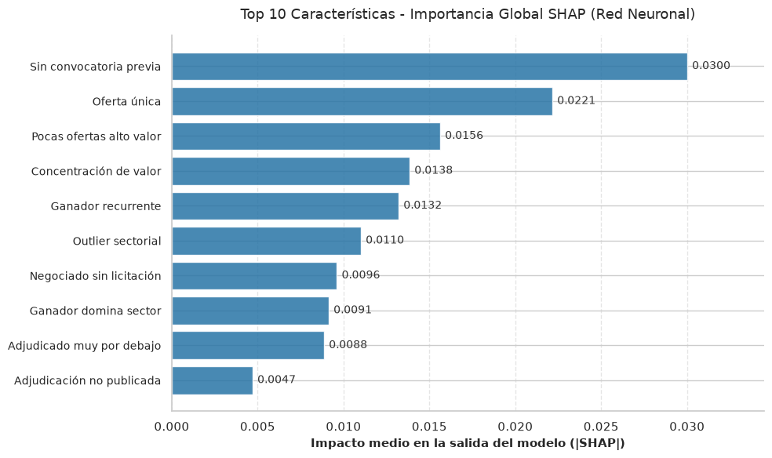

En la Figura 11 dominan las *red flags* de acceso a la competencia: sin convocatoria previa (|SHAP| medio 0,03), oferta única (0,0221) y pocas ofertas en contratos de alto valor (0,0156) son las tres que más mueven la predicción, en línea con la literatura OCDE. Que el modelo las coloque arriba por sí solo, sin que se le haya indicado nada, es buena señal de coherencia. Comparado con la feature importance del Random Forest, ambos coinciden en el top 3; la diferencia es que SHAP sube `RF_FEW_BIDS_HIGH_VALUE` al tercer puesto porque captura el impacto marginal con interacciones, mientras la importance del RF mide la reducción de impureza en los árboles.

También en el análisis individual: para contratos marcados con *score* alto, el force plot mostraba tres o cuatro *red flags* de competencia y comportamiento del ganador explicando casi todo el *score*. En casos con contribuciones contraintuitivas (*red flags* empujando a la baja), SHAP evidencia que el modelo no solo suma señales: también las compensa. Las continuas, en cambio, quedan abajo en la DNN —dominan las binarias alineadas con la etiqueta—, mientras que en el autoencoder sí pesan, porque el error de reconstrucción es sensible a los valores extremos de las continuas.

## 7. Productivización

Un modelo que solo vive en un notebook no le sirve a nadie. Por eso la última fase del trabajo se dedicó a montar una demo de inferencia que cubriera dos escenarios: uno *online*, en el que llega una adjudicación nueva y hay que puntuarla al momento, y uno *batch*, en el que hay un conjunto acumulado que se puntúa de golpe.

Para el caso *online* se montó una función `predecir()` que recibe un diccionario con las 27 *features* y devuelve un JSON con el *score* de riesgo (0-1), una etiqueta cualitativa (BAJO, MEDIO, ALTO según umbrales 0,3 y 0,7) y la lista de *red flags* activas. Internamente carga los modelos de Keras y sklearn desde disco, aplica el mismo escalado del entrenamiento y consulta los tres modelos (DNN, autoencoder, Isolation Forest); el Random Forest de Spark se queda para el *scoring* *batch* masivo porque requiere una sesión activa que no encaja en una API ligera. En una prueba de 1.000 adjudicaciones la latencia media fue de 0,21 ms por predicción, perfectamente usable para producción; la mayor parte del tiempo se va en la carga inicial de modelos, no en la inferencia. La división de roles para despliegue real: RF de Spark para *batch* distribuido sobre el histórico; los modelos ligeros de Keras/sklearn (4.961 y 1.908 parámetros) para la inferencia *online*.

Un punto relevante para Negocio es que `predecir()` devuelve no solo el *score* sino la lista de *red flags* activas: en lugar de "este contrato es sospechoso" sin más, el output dice "es sospechoso porque tiene oferta única, sin convocatoria previa y el ganador es recurrente". Ese nivel de explicación permite a un auditor empezar a trabajar el caso sin re-revisar todos los datos: es la diferencia entre un sistema que prioriza y uno que prioriza y justifica. El detalle técnico está en el Anexo E.

## 8. Dashboard interactivo en Tableau

Como complemento al motor de inferencia, se construyó un *dashboard* en Tableau Public sobre una muestra de 500.000 adjudicaciones del *parquet* (aleatoria, *seed* 0, que mantiene las proporciones de la tabla maestra: 5,24% de positivos y 86,10% de procedimientos abiertos, a diferencia de una muestra estratificada 50/50 que distorsionaría todas las agregaciones). El sistema se compone de dos libros de trabajo: un primer libro (Libro2) sobre el que se iteró el diseño, y una versión final consolidada (Libro3) que es la que se presenta.

**Diseño de datos y métricas.** El *dashboard* expone las dos métricas de riesgo complementarias del trabajo: `Score_Modelo` (0-1, la señal de priorización generada por la DNN con entity *embeddings*) e `Indice_Riesgo` (0-1, la suma ponderada de las 22 *red flags* OCDE que sirve de explicación interpretable), más la variable categórica `Etiqueta_Riesgo` (0 = sin riesgo alto, 1 = alto riesgo, 5,24% de prevalencia). La regla de diseño es usar el *score* para priorizar qué revisar y el índice para explicar por qué.

**Vista ejecutiva (Dashboard 1).** Cabecera con título institucional, logotipo TED y selector de año, con tres columnas (Figura 12): a la izquierda la evolución temporal 2018-2023 por país, resuelta con un doble eje sincronizado de `AVG(Score_Modelo)` que superpone una línea negra continua de promedio global anual sobre las series nacionales sin romper la escala; en el centro cinco tarjetas KPI (nº de *red flags* medias, total de adjudicaciones, valor total adjudicado, % de alto riesgo con formato porcentual, y valor adjudicado en contratos de alto riesgo); a la derecha el mapa coroplético por país con gradiente continuo y leyenda normalizada (*score* 0,0010 - 0,4111).

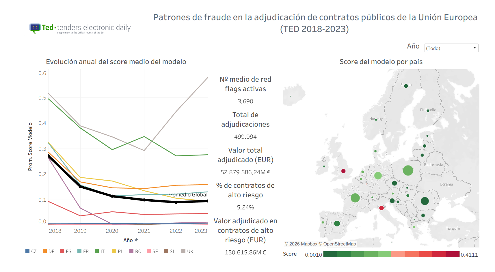

**Vista de investigación (Dashboard 2).** Barra superior de filtros (selección de eje Y, año con *slider*, sector CPV y tipo de procedimiento) y disposición matricial 2×2 (Figura 13). El *scatter* dinámico cruza `Score_Modelo` (eje X) con un eje Y gestionado por parámetro que se filtró a las variables con dispersión real (valor estimado, valor de adjudicación, nº de *red flags* activas), eliminando las opciones que degeneraban en rectas planas o colapsos discretos (ratios adjudicado/estimado, desviación sectorial, nº de ofertas). El eje Y usa notación científica para cubrir 17 órdenes de magnitud sin saturar los márgenes, y el *overplotting* se trata con opacidad al 13-15%, tamaño de punto mínimo y la categoría de alto riesgo reordenada al frente de la leyenda. El panel derecho muestra la frecuencia de las 22 *red flags* en "vista completa", y la parte inferior una tabla Top 10 de adjudicaciones de mayor riesgo (índice, país, sector, procedimiento, valor con separador de miles, *red flags* activas) con un botón textual "Ver flags" que abre un *tooltip* enriquecido con las alertas activas.

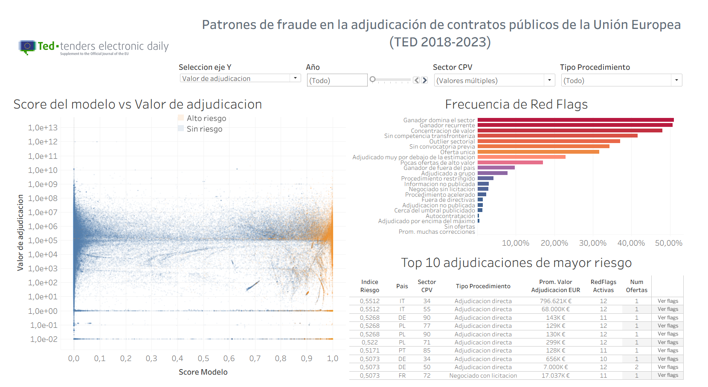

**Decisiones de diseño.** El lienzo es 16:9 fijo (1600×900, escalable a 1080p) para evitar deformaciones, y la interactividad se apoya en acciones de filtro cruzado on-select desde el mapa y la evolución hacia las vistas analíticas. Durante la iteración se detectó y corrigió un bug en el eje Y dinámico (nombres de opciones del parámetro inconsistentes con el CASE de la fórmula, que dejaba el *scatter* vacío en dos opciones) y se descartaron visualmente las dimensiones sin capacidad discriminante, dejando el parámetro en tres variables útiles. Los dos libros y el detalle de construcción están en los anexos de la entrega.

## 9. Conclusiones y trabajo futuro

Este trabajo ha dado como resultado final una herramienta analítica que combina las 22 *red flags* de la OCDE con cuatro modelos de *machine learning* para detectar patrones de fraude en 4.256.060 adjudicaciones de contratos públicos de la UE entre 2018 y 2023. La herramienta entrega, para cada adjudicación, un *score* de riesgo basado en las reglas OCDE (DNN), un *score* de anomalía basado en patrones no supervisados (autoencoder e Isolation Forest), y un *score* robusto basado en árboles (Random Forest). Con esos *scores*, un equipo de Auditoría Pública puede ordenar adjudicaciones por prioridad y decidir cuáles merecen una revisión manual.

Conviene ser honesto con las limitaciones, porque son varias y son importantes. La primera es que no se dispone de etiquetas reales de fraude. TED no confirma qué contratos son fraudulentos y cuáles no. La etiqueta `RF_LABEL` es un proxy construido a partir de las propias *red flags*, lo que implica que los modelos supervisados están aprendiendo a reproducir un criterio basado en reglas, no a detectar fraude confirmado. La segunda, y la más costosa de identificar, es que la DNN y el Random Forest originales sufrían de circularidad: la etiqueta es una función de las mismas *features* que reciben, así que sus métricas altas (AUROC 1,0) no demuestran nada. Se resolvió con los experimentos A y B, que eliminan las *red flags* de la entrada y usan variables crudas y *embeddings*, y ahí las métricas bajan a valores honestos (AUROC 0,98, AUPRC 0,83). La tercera es que los resultados no se han validado con casos judiciales reales ni con bases de datos de OLAF o de autoridades nacionales de auditoría. Sin esa validación externa, los *scores* son una priorización basada en heurísticas y en aprendizaje no supervisado, no una prueba de fraude.

Aun con esas limitaciones, el enfoque resulta útil. En un contexto donde no hay etiquetas y donde el volumen de datos es enorme, lo razonable es construir un sistema que ayude a priorizar, no que pretenda sentenciar. Eso es exactamente lo que este trabajo ha construido.

Para trabajo futuro se identifican varias líneas. La primera es añadir *embeddings* de texto: los contratos en TED tienen un título descriptivo que, tratado como texto, puede capturar similitudes entre contratos que las variables estructuradas no ven; en el experimento B ya se usaron *embeddings* para las categóricas (comprador, ganador, CPV, país), y un *embedding* del título con un modelo preentrenado podría alimentar al autoencoder. La segunda es validar con bases externas: cruzar los *scores* altos con bases de datos de OLAF, de la Oficina Anticorrupción española o de autoridades equivalentes, para ver si los contratos que el sistema marca arriba coinciden con casos investigados —eso daría una medida real de precisión de la que ahora se carece. La tercera es conectar el *dashboard* de Tableau a la API de inferencia para que las vistas se actualicen con *scoring* en tiempo real sobre adjudicaciones nuevas, en lugar de operar sobre la muestra estática de 500.000 filas.

Junto a esas líneas cabe mencionar la calibración de los pesos de las *red flags* —asignados a partir de la severidad cualitativa del *handbook*, y que un panel de expertos podría ajustar: el sistema está preparado, cambiar los pesos es cambiar una lista de 22 números y recalcular el `RF_SCORE`—; los modelos semi-supervisados (*self-training* o *co-training*, aprovechando la pequeña fracción de etiquetas "confiables" y una mayoría sin etiqueta fiable, o aprendizaje por refuerzo ajustando pesos según el feedback de los auditores); y un módulo de seguimiento temporal, que calcularía con *window functions* la variación del `RF_SCORE` de cada comprador y ganador a lo largo del tiempo y dispararía alertas ante cambios bruscos, acercando el sistema a un *monitoring* continuo en lugar de un *scoring* puntual.

## 10. Bibliografía

- OCDE (2016). *Government at a Glance 2016: Procurement*. OECD Publishing, Paris. Sección sobre red flags de riesgo en contratación pública.
- European Union. *Tenders Electronic Daily (TED)*. data.europa.eu. Dataset de Contract Notices y Contract Award Notices, 2018-2023.
- Lundberg, S. M. y Lee, S. I. (2017). *A Unified Approach to Interpreting Model Predictions*. Advances in Neural Information Processing Systems (NeurIPS).
- Liu, F. T., Ting, K. M. y Zhou, Z. H. (2008). *Isolation Forest*. IEEE International Conference on Data Mining.
- Breiman, L. (2001). *Random Forests*. Machine Learning, 45(1), 5-32.
- Chollet, F. y colaboradores. *Keras Documentation*. keras.io.
- Apache Software Foundation. *Spark MLlib Documentation*. spark.apache.org.
- Pedregosa, F. y colaboradores. *Scikit-learn: Machine Learning in Python*. Journal of Machine Learning Research, 12 (2011).
- Davis, J. y Goadrich, M. (2006). *The Relationship Between Precision-Recall and ROC Curves*. Proceedings of the 23rd International Conference on Machine Learning (ICML).
- Comisión Europea. *Estudios de integridad en la contratación pública*. Publicaciones de DG GROW sobre coste del fraude en contratación pública en la UE.